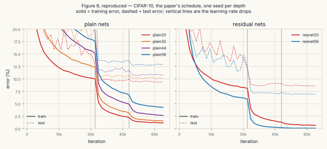
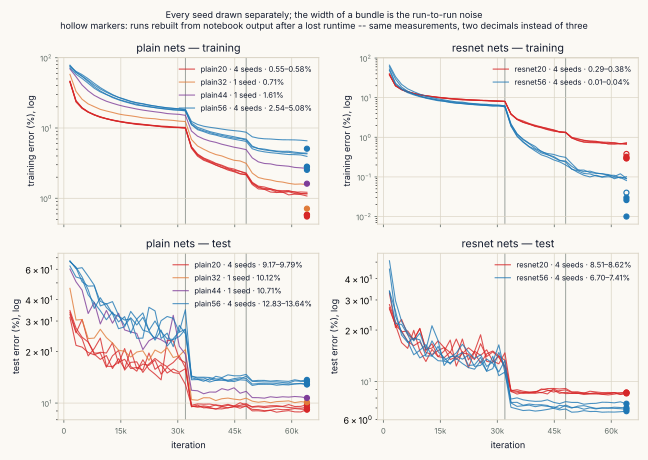
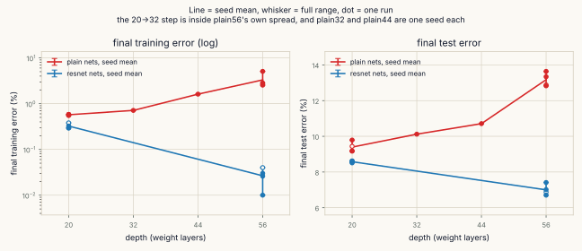
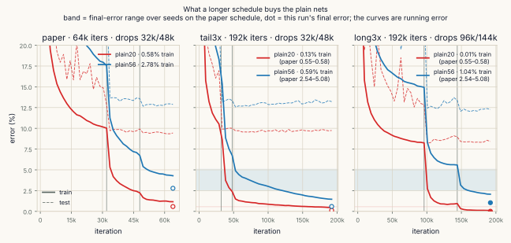
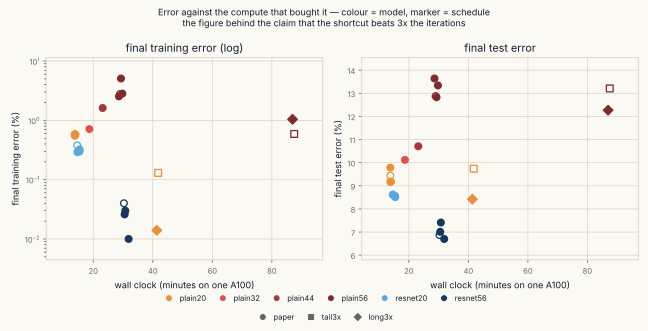
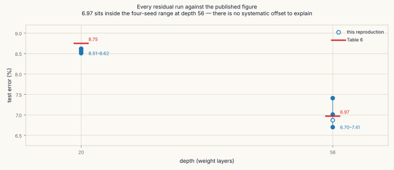

# ResNet

[Deep Residual Learning for Image Recognition](https://arxiv.org/abs/1512.03385) —
Kaiming He, Xiangyu Zhang, Shaoqing Ren, Jian Sun, CVPR 2016.

The CIFAR-10 architecture of §4.2 built from the paper's own description and
checked against Table 6, then used to test the paper's central claim: that a
deeper **plain** net fits the **training** set worse than a shallower one. Ten
configurations, twenty-two runs, every hyperparameter quoted from §4.2.

**What this is not:** an ImageNet reproduction. Nothing here touches ILSVRC;
§4.2's CIFAR experiments are the whole scope. And the headline numbers come with
a seed spread that turned out to be larger than the effect the paper quotes —
[what was and was not reproduced](#what-was-and-was-not-reproduced) says which
claims survived it.

---

## The claim is about training error

> "with the network depth increasing, accuracy gets saturated (which might be
> unsurprising) and then degrades rapidly. Unexpectedly, such degradation is
> **not caused by overfitting**, and adding more layers to a suitably deep model
> leads to higher **training** error" — §1

Test error going up with depth has an easy explanation, and §1 spends its first
page ruling that explanation out. The claim that needs reproducing is the
awkward one: the deeper net is worse on data it has already seen. Every
comparison here is therefore on training error measured with augmentation
switched off, which is a different quantity from the running error the curves
plot during training.

<picture>
  <source media="(prefers-color-scheme: dark)" srcset="figures/figure6-dark.svg">
  
</picture>

## 6n+2, and what the count leaves out

§4.2 gives the architecture in five sentences: one 3×3 convolution, then 6n
layers over feature maps of {32, 16, 8} with {16, 32, 64} filters, subsampling by
stride-2 convolutions, then global average pooling and a 10-way
fully-connected layer. `cifar_resnet.py` builds exactly that and checks the
totals:

| depth | n | weight layers | parameters | Table 6 | match |
|---|---|---|---|---|---|
| 20 | 3 | 20 | 269,722 | 0.27M | yes |
| 32 | 5 | 32 | 464,154 | 0.46M | yes |
| 44 | 7 | 44 | 658,586 | 0.66M | yes |
| 56 | 9 | 56 | 853,018 | 0.85M | yes |
| 110 | 18 | 110 | 1,727,962 | 1.7M | yes |

"20 layers" counts convolutions and fully-connected layers only. ResNet-20 also
holds 19 BatchNorm layers, so 39 of its modules carry learnable weights. The
paper's depth is a naming convention, not an inventory.

The parameter counts of a plain net and its residual twin are **identical** at
every depth, because §4.2 uses option A everywhere: on a dimension change the
shortcut subsamples by taking every other pixel and zero-pads the new channels.
No parameters, no arithmetic. That identity is what makes the comparison a
controlled one, and it is the first thing to check in any reimplementation.

## The floor: what a block does when it learns nothing

§1's construction argument says a deeper net can always copy a shallower one and
set the added layers to identity, so it should never be worse. `floor.py`
measures what each architecture actually falls back to. Set every block's
convolution weights to zero — the "learned nothing" state — and push a
non-negative input through all 27 blocks of a 56-layer net:

```
              params     ReLUs   weight layers
   plain56   853,018        55              56
  resnet56   853,018        55              56

   after block   plain56 norm   resnet56 norm
             1           0.00          180.21
            10           0.00           89.76
            19           0.00           44.05
            27           0.00           44.05
```

The plain net's signal is gone after one block. The residual net's input
survives all twenty-seven, shrunk only by the two stride-2 subsamplings.

Both nets have the same 55 ReLUs. The shortcut adds a **linear** bypass, not
non-linearity — which is the point, and the opposite of a common intuition. An
identity path is what lets a deep net behave like a shallow one.

Three conditions have to hold for that bypass to be an identity, and §4.2 states
only the first: the channel count must match, the spatial size must match, and
the input must already be non-negative, so the ReLU after the addition is
harmless. The third is why the shortcut can only be placed immediately after a
ReLU.

## What the seeds did to the headline number

A single pair of runs gives plain56 − plain20 = +2.20 points on training error,
which reads like a measurement. Four seeds say otherwise:

<picture>
  <source media="(prefers-color-scheme: dark)" srcset="figures/seeds-dark.svg">
  
</picture>

| model | seeds | final training error |
|---|---|---|
| plain20 | 4 | 0.55 – 0.58% |
| plain56 | 4 | **2.54 – 5.08%** |
| resnet20 | 4 | 0.29 – 0.38% |
| resnet56 | 4 | **0.01 – 0.04%** |

plain20 is steady to within 0.03 points. plain56 moves 2.5 points between runs —
more than the whole effect. Degradation reproduces in every seed, but its *size*
is not a number this experiment can quote.

The residual comparison is the opposite case. Per seed, resnet56 − resnet20 is
−0.340, −0.288, −0.298 and −0.262 points: a spread of 0.078 against a mean of
−0.297, so the effect is about four times its own noise. It was eight times on
the first three seeds; the fourth doubled the spread on its own, which is what a
spread measured from three draws is worth. The claim survives either way, and the
clearer reading is that resnet56 reaches the floor every time — 0.01–0.04%, five
to twenty images in 50,000 — while resnet20 never gets there.

`train_cifar.py` prints the per-seed gaps and the spread at the end of every run,
and refuses to print a verdict when only one seed was run.

Across depths the two families open like a pair of scissors — plain error rising,
residual error falling — but only the ends of the plain line carry seeds:

<picture>
  <source media="(prefers-color-scheme: dark)" srcset="figures/depth-dark.svg">
  
</picture>

## Footnote 3, measured two ways

> "We have experimented with more training iterations (3×) and still observed
> the degradation problem" — footnote 3

"3× iterations" can mean two different experiments, and they answer different
questions. `tail3x` keeps the drops at 32k/48k and runs to 192k, so its first
64,000 iterations are the same experiment as `paper` — same seed, same learning
rates — and its endpoint is directly comparable. `long3x` stretches the whole
schedule to 96k/144k, which is a genuinely longer run but comparable to nothing
already done.

The two *curves* still cannot be laid on top of each other, and the reason is
worth knowing before reading any of the panels below. Every run logs forty
points, so the window the running error is averaged over scales with the
schedule: 1,600 iterations in `paper`, 4,800 in `tail3x`. At iteration 4,800
plain20 reads 19.45% on one and 28.88% on the other, from the same trajectory:
the wider window is still averaging in the first 3,200 iterations that the
narrow one has already left behind. The final
numbers are unaffected, because each is a separate clean pass over the training
set rather than a point on the curve.

<picture>
  <source media="(prefers-color-scheme: dark)" srcset="figures/schedules-dark.svg">
  
</picture>

| | plain20 train | plain56 train | plain20 test | plain56 test |
|---|---|---|---|---|
| `paper`, 64k, 4 seeds | 0.55 – 0.58% | 2.54 – 5.08% | 9.17 – 9.79% | 12.83 – 13.64% |
| `tail3x`, 192k, 1 seed | 0.13% | 0.59% | 9.74% | 13.21% |
| `long3x`, 192k, 1 seed | 0.014% | 1.04% | 8.42% | 12.27% |

Both long runs put plain56 below the *minimum* of its own four-seed range at 64k,
so the extra iterations genuinely help it. How much they help is one run per
schedule and has no error bar — a first attempt at this quoted a 79% shrink in
the gap, which compared one draw against one draw and did not survive the seeds.

One thing the extra iterations did not buy: plain56 at 192,000 iterations reaches
0.59%, and plain20 at 64,000 reaches 0.55–0.58%. The same fit, three times the
budget. The paper calls this an optimization difficulty and puts no price on it.

## What the shortcut is worth, in minutes

<picture>
  <source media="(prefers-color-scheme: dark)" srcset="figures/cost-dark.svg">
  
</picture>

resnet56 reached 0.01–0.04% training error in about 31 minutes on one A100.
plain56 reached 0.59% in 88 minutes. Three times the wall clock and still an
order of magnitude behind — against a `+` that costs no parameters and no
arithmetic.

## What was and was not reproduced

**Reproduced.**

- All five depths match Table 6's parameter counts, and plain and residual nets
  of a given depth hold identical weight counts.
- Degradation, in every seed: plain56 fits the training set worse than plain20 in
  all four runs.
- The residual reversal, with an effect about four times its own spread.
- Table 6's test error. resnet20 gives 8.51–8.62% against a published 8.75%;
  resnet56 gives 6.70–7.41% against a published 6.97%, which sits inside that
  range.

**Not established.**

- **The size of the degradation.** plain56's 2.5-point seed spread is larger than
  the effect; only its sign is stable.
- **The 20 → 32 step.** The depth series reads 0.58 → 0.71 → 1.61 → 2.78, which
  looks monotone, but plain32 and plain44 were run once each. Depths 44 and 56
  are clearly worse than 20; the first step is inside the noise.
- **The residual depth trend.** resnet32 and resnet44 were never run, so
  "residual error falls with depth" rests on two points.
- **Where plain56's floor is.** It was still descending at 192,000 iterations.
- **Any depth beyond 56.** ResNet-110 and the 1202-layer net were not run.

An earlier version of this README claimed the reproduction ran consistently
0.1 points better than Table 6 and guessed at a 45k/50k training-set difference.
Four seeds killed it: 6.97 sits in the middle of 6.70–7.41. The claim came from
one run.

<picture>
  <source media="(prefers-color-scheme: dark)" srcset="figures/table6-dark.svg">
  
</picture>

## Running it

```bash
python prepare_data.py --data ./dataset       # fetch CIFAR-10, verify every md5
python cifar_resnet.py                        # architecture against Table 6
python floor.py                               # the construction argument
python train_cifar.py --models plain20 --schedule smoke     # ~1 min, checks it runs
python train_cifar.py --models plain20 plain56 resnet20 resnet56 --seeds 0 1 2
python analyze.py                             # the comparisons, as numbers
python verify.py                              # non-zero exit if a file disagrees with itself
python figures.py                             # the figures in this README
```

No path is hardcoded. `RESNET_DATA`, `RESNET_OUT`, `RESNET_MIRROR` and
`RESNET_FIGS` override the defaults.

`--mirror` copies each finished JSON somewhere else and compares it byte for
byte. That exists because a network-mounted folder accepted a write, reported
success, and never persisted it — one full set of results was lost that way and
had to be transcribed back out of printed notebook output by
`rebuild_from_log.py`. Those files carry `"RECONSTRUCTED": true` and are drawn as
hollow markers in every figure.

| schedule | iterations | lr drops |
|---|---|---|
| `paper` | 64,000 | 32k, 48k |
| `tail3x` | 192,000 | 32k, 48k |
| `long3x` | 192,000 | 96k, 144k |
| `short` | 8,000 | 4k, 6k |
| `smoke` | 200 | 100, 150 |

## Details most implementations get wrong

**Projection shortcuts everywhere.** §4.2 is explicit that CIFAR uses option A —
parameter-free — precisely so the residual nets have "exactly the same depth,
width, and number of parameters as the plain counterparts". An implementation
that reaches for a 1×1 projection on dimension changes gives the residual net
more parameters than its plain twin, and the controlled comparison is gone. If a
reimplementation's plain and residual parameter counts differ, that is the bug.

**Measuring training error with augmentation on.** The running error printed
during training is computed on random crops of random flips, in `train()` mode.
It is not the training error the degradation claim is about. Here the final
number is a separate pass over the same 50,000 images with augmentation off, in
`eval()` mode, and the two differ by enough to matter: plain56's running error
ends at 4.29% where its clean error is 2.78%.

**A one-layer residual block.** With one weight layer, `F(x) + x = (W₁ + I)x` —
the same function set as a plain convolution, with the shortcut buying nothing.
§3.2 notes this. Two layers resist the collapse because of the ReLU *inside* F.

**Forgetting `.eval()` when checking identity behaviour.** BatchNorm in `train()`
mode normalises by the batch's own statistics, so a block that should pass its
input through unchanged does not, and nothing raises.

**Counting BatchNorm.** It never appears in the paper's layer counts. Neither do
ReLU or pooling.

## Caveats

- Per-channel mean and standard deviation; §4.2 subtracts the per-pixel mean.
- Training uses all 50,000 images. §4.2 determined the schedule on a 45k/5k
  split; that schedule is taken as given here.
- One A100, not the paper's two GPUs. Batch size 128 either way.
- A seed moves both the initialisation and the order the training images arrive
  in — the data loader is built once and reused, but `RandomSampler` draws its
  own seed from the global generator at the start of every pass. Checked, not
  assumed.
