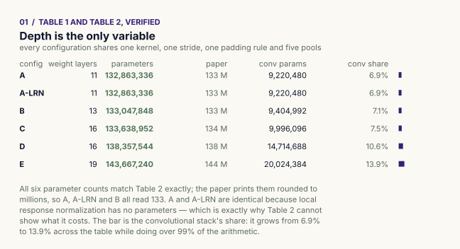
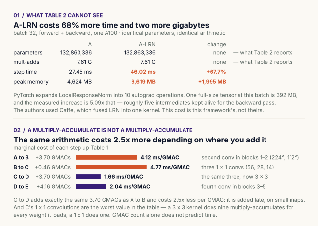
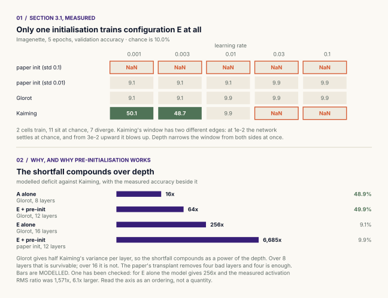
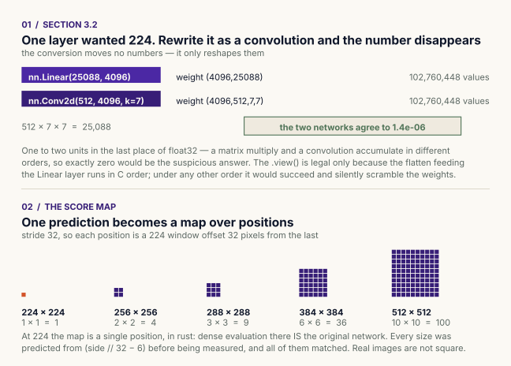
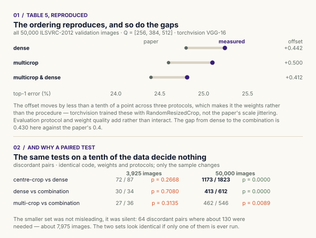
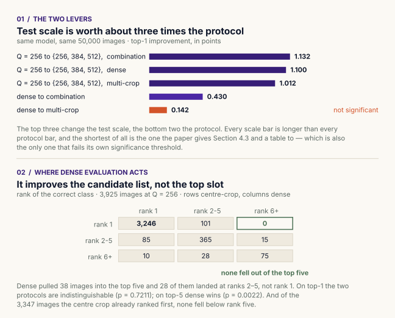

# VGG

[Very Deep Convolutional Networks for Large-Scale Image Recognition](https://arxiv.org/abs/1409.1556) —
Karen Simonyan, Andrew Zisserman, ICLR 2015.

Six architectures checked against the paper's own tables, and the paper's
test-time procedure re-run on the paper's own validation set — 50,000 ILSVRC-2012
images, with the comparisons written down before the numbers were looked at.

**What this is not:** a retraining of VGG. The architectures here are built from
scratch and verified; the weights used for the evaluation study are
torchvision's. [What was and was not reproduced](#what-was-and-was-not-reproduced)
is set out below rather than left for a reader to work out.

---

## Depth is the only variable

<picture>
  <source media="(prefers-color-scheme: dark)" srcset="figures/configs-dark.svg">
  
</picture>

All six configurations share one receptive field (3×3), one stride, one padding
rule, five max-pool stages and three fully-connected layers. That is the whole
design: hold everything constant, vary depth, and the error difference can be
attributed to depth.

All six parameter counts match Table 2 exactly. A and A-LRN are identical because
local response normalization has no parameters — which is also why Table 2 cannot
show what it costs.

### Why 3×3 stacks

Three stacked 3×3 layers see the same 7×7 receptive field as one 7×7 layer but
cost 27C² weights against 49C² — the single layer is 81% more expensive. The
stack also applies three non-linearities instead of one.

That second point is doing all the work and it is easy to read past.
**Convolution is linear, so two stacked 3×3 convolutions with no activation
between them collapse exactly into one 5×5 convolution.** The depth argument is
an argument about the ReLUs, not about the kernels. Remove them and the stack is
not deep, it is a more awkward way of writing a wider kernel.

---

## What Table 2 cannot see

<picture>
  <source media="(prefers-color-scheme: dark)" srcset="figures/cost-dark.svg">
  
</picture>

Table 2 quantifies cost as parameters, and by that measure some things are free
that are not. The paper's only remark on what LRN costs is that it "leads to
increased memory consumption and computation time" (§4.1), with no figure
attached. Measured: **68% more time and two more gigabytes**, for a layer that
changes neither the parameter count nor the arithmetic.

PyTorch expands `LocalResponseNorm` into ten autograd operations, about five of
which keep a full-size intermediate alive for the backward pass. The authors used
Caffe, which fused it — so this cost is this framework's, not theirs.

The second panel is the more generally useful one. **A multiply-accumulate is not
a multiply-accumulate.** Going C→D adds exactly the same 3.70 GMACs as A→B and
costs 2.5× less per GMAC, because it is added late on small maps rather than
early on large ones. And C's 1×1 convolutions are the worst value in the table: a
3×3 kernel does nine multiply-accumulates for every weight it loads, a 1×1 does
one.

### One more, which is a lesson about measurement

`nn.ReLU(inplace=True)` was predicted to save ~784 MB. Measured at the global
peak: **0.0 MB.** Measured at the *forward* peak: **392 MB.**

Both numbers are right. The saving is real and it is in the forward pass; it is
invisible in the global peak because that peak is set during backward, when the
stored activations are being consumed anyway. Report only the global peak and you
report zero for an effect of several hundred megabytes.

---

## Section 3.1 — why the deep nets needed pre-initialisation

<picture>
  <source media="(prefers-color-scheme: dark)" srcset="figures/init-dark.svg">
  
</picture>

Read once, the paper's pre-initialisation procedure looks like an engineering
workaround. Run it and it is the difference between a network that learns and one
that does not.

Of twenty cells, **two train**. Only Kaiming, and only at the two lowest rates.
Its usable window has two different edges — at 1e-2 the network settles at chance
and from 3e-2 upward it diverges — so depth narrows the window from both sides at
once.

Glorot supplies half Kaiming's variance per layer, so the shortfall in standard
deviation compounds as a power of the depth: survivable over 8 layers, not over
16. The paper's transplant removes four bad layers, and four is enough.

**One part could not be reproduced.** The paper trains its donor A with its own
random initialisation. That initialisation does not train configuration A here
either, at any rate tried, so the paper's donor does not exist to copy from. The
donor used is Kaiming-trained, which makes this a test of whether a trained A
rescues E — not a test of the paper's method end to end. The deficit bars are
*modelled*; one has been checked against a measurement and the model understates
it six-fold, so read that axis as an ordering, not a quantity.

---

## Section 3.2 — the one layer that ever needed 224

<picture>
  <source media="(prefers-color-scheme: dark)" srcset="figures/conversion-dark.svg">
  
</picture>

Every description of VGG begins by saying it takes a 224×224 input. Only one
layer in it ever required that. The convolutions never cared — they slide. The
constraint is the first fully-connected layer, which demands exactly
7·7·512 = 25,088 numbers.

A `Linear(25088, 4096)` and a `Conv2d(512, 4096, kernel_size=7)` hold the same
102,760,448 weights in the same order. The conversion reshapes; it does not
retrain, and the two networks agree to **1.4 × 10⁻⁶** — one or two units in the
last place of float32.

Once it is a convolution it can slide, and a larger input yields a **class score
map** instead of one prediction. The network's stride is 32, so each score-map
position is a 224×224 window offset 32 pixels from the last: dense evaluation is
multi-crop at every 32-pixel offset, for the cost of one pass, because the
convolutional work underneath is shared.

---

## Table 5, reproduced

<picture>
  <source media="(prefers-color-scheme: dark)" srcset="figures/table5-dark.svg">
  
</picture>

| Protocol | top-1 | top-5 | Paper, Table 5 |
|---|---:|---:|---|
| dense | 25.242% | 7.764% | 24.8 / 7.5 |
| multi-crop | 25.100% | 7.676% | 24.6 / 7.5 |
| multi-crop & dense | **24.812%** | **7.420%** | 24.4 / 7.2 |

The ordering reproduces. So do the gaps — dense to the combination is 0.430 here
against the paper's 0.4.

The ~0.45 point offset is the **weights**, not the protocol: torchvision trained
these with `RandomResizedCrop` rather than the paper's scale jittering. The
evidence is that the offset barely moves across three protocols (0.442, 0.500,
0.412), which makes evaluation protocol and weight quality additive rather than
interacting.

Six comparisons, declared before the numbers were seen, Bonferroni threshold
0.0083:

| Comparison | p | |
|---|---:|---|
| top-1 dense vs multi-crop | 0.1448 | not distinguishable |
| top-5 dense vs multi-crop | 0.2464 | not distinguishable |
| top-1 dense vs combination | 0.0000 | **combination better** |
| top-5 dense vs combination | 0.0000 | **combination better** |
| top-1 multi-crop vs combination | 0.0000 | **combination better** |
| top-5 multi-crop vs combination | 0.0002 | **combination better** |

The paper's headline claim holds on both metrics. That dense and multi-crop
cannot be told apart is consistent with the paper's own figures, which give the
two an identical 7.5 on top-5.

Before any of this, the pipeline was checked against an external reference:
centre-crop without flipping gives **28.418%** top-1 against the **28.408%**
torchvision publishes for these weights — five images in fifty thousand.

---

## Which lever actually moves the number

<picture>
  <source media="(prefers-color-scheme: dark)" srcset="figures/levers-dark.svg">
  
</picture>

Section 4.3 and a table go to choosing multi-crop over dense. Measured, that
choice is worth **0.142 points** and does not survive its own threshold.
Averaging the same model over Q = {256, 384, 512} instead of Q = 256 alone is
worth **1.01 to 1.13 points**, p = 0.0000 for both protocols.

Both results are in the paper — Table 4 has the scale gain, Table 5 the protocol
gain — but they sit in different tables with different baselines and nothing
invites the reader to put them side by side. Doing so reverses which one looks
important.

The second panel says where dense evaluation acts. At a single scale it beats
centre-cropping clearly on top-5 (p = 0.0022) and not at all on top-1 (p = 0.72),
and of the 38 images it pulls into the top five, **28 land at ranks 2–5 rather
than rank 1**. Meanwhile, of the 3,347 images the centre crop already ranked
first, **none** fell below rank five. Averaging over windows dilutes a confident
right answer; it does not destroy one.

A plainer explanation competes with that one — images the centre crop ranks first
are the easy ones, and easy images survive any window. The two were not separated.

---

## Why every comparison here is a paired test

Dense evaluation and centre-cropping score 14.73% and 14.88% top-1 on the same
3,925 images. A difference of 0.15 points, six images. It would be easy to
explain, and the explanation would be fiction — the two protocols actually
disagree on **196** images, with dense getting 95 right that cropping misses and
cropping getting 101 right that dense misses. The aggregate hides both facts: that
neither is better, and that they are very different predictors.

Which is exactly why the paper can say they are *complementary* and that combining
them beats each alone. The disagreement is the raw material of the combination.

The same tests on a tenth of the data decide nothing, with identical code and
weights:

| Comparison, top-1 | 3,925 images | 50,000 images |
|---|---|---|
| centre-crop vs dense | 72 / 87, p = 0.27 | 1173 / 1823, **p = 0.0000** |
| dense vs combination | 30 / 34, p = 0.71 | 413 / 612, **p = 0.0000** |
| multi-crop vs combination | 27 / 36, p = 0.31 | 462 / 546, p = 0.0089 |

The smaller set was not misleading, it was **silent** — 64 discordant pairs where
about 130 were needed. The two look identical if only one of them is ever run.

---

## What was and was not reproduced

**Reproduced**

- Table 1 and Table 2: all six configurations, parameter counts exact
- §3.2's FC-to-convolutional conversion, to float32 round-off
- Score-map geometry, predicted from the formula then measured, seven cases
- Table 5's ordering and gaps, on the paper's own validation set
- Table 4's claim that scale jittering at test time helps
- Table 5's implicit claim that dense and multi-crop are near-equivalent alone

**Not reproduced**

- **Training.** No network here was trained to convergence on ImageNet. The
  evaluation study uses torchvision's pretrained configuration D.
- **The paper's own initialisation.** It does not train configuration A here, so
  the donor its pre-training procedure requires could not be produced.
- **Table 4's Q = {S−32, S, S+32} finding.** torchvision's weights have no
  training scale S to be near or far from.
- **§4.4 ConvNet fusion** — ensembling several trained networks.

**Measured here, not in the paper**

- What A-LRN actually costs in time and memory
- Milliseconds per GMAC for each step up Table 1
- That the protocol's benefit is nearly independent of weight quality
- That the scale lever is roughly three times the protocol lever
- That dense evaluation improves the candidate list rather than the top slot, and
  never pushes a correct answer out of the top five

---

## Running it

```bash
pip install -r ../requirements.txt

python vgg.py                                  # architecture checks, no data, no GPU
python figures.py                              # all figures, from results/, no GPU

python cost.py                                 # needs a CUDA GPU
python init_study.py  --data path/to/imagenette2
python dense_eval.py  --data path/to/imagenet/val
python analysis.py    --compare dense:multicrop dense:"multicrop_and_dense" \
                      --ranks crop:dense
```

| File | What it does |
|---|---|
| [`vgg.py`](vgg.py) | The six configurations, the §3.2 conversion, and their checks |
| [`cost.py`](cost.py) | LRN's cost, the in-place ReLU question, arithmetic intensity |
| [`init_study.py`](init_study.py) | §3.1 on Imagenette: the initialisation grid and the transplant |
| [`dense_eval.py`](dense_eval.py) | §3.2 / 4.2 / 4.3 on ILSVRC: dense, multi-crop, combination |
| [`analysis.py`](analysis.py) | McNemar, rank migration, power — on saved posteriors |
| [`figures.py`](figures.py) | Every figure, drawn from `results/`. Measures nothing. |
| [`results/`](results/) | Every measured number, as JSON, with its provenance |
| [`VGG.ipynb`](VGG.ipynb) | The study as a narrative, in the order it was worked out |

**Measurement and presentation are separate on purpose.** The scripts write
numbers to `results/`; `figures.py` only draws them. So the figures regenerate on
a laptop without an A100 or ImageNet, and every number on a figure traces to a
line in a JSON file rather than to something typed into a plotting script once and
never checked again.

`results/*.json` carries the figures measured on one NVIDIA A100-SXM4-80GB.
Re-running the scripts overwrites them with yours. Absolute milliseconds are
hardware; the ratios and the directions are the result.

---

## Details most implementations get wrong

**Leaving torchvision's `AdaptiveAvgPool2d((7, 7))` in the dense model.**
torchvision inserts it so its `Linear` classifier accepts any input size. It
solves the same problem §3.2 solves, but by throwing the spatial resolution away
rather than keeping it. Left in, it forces a 1×1 score map at every Q, raises no
error, and silently turns dense evaluation back into single-crop evaluation.

**Averaging in the wrong space.** The score map is averaged *before* the softmax,
in logit space. The original and flipped images are averaged *after* it, in
posterior space. Across test scales, posteriors are averaged again. The paper
states all three; they are different operations in different places.

**Assuming `.view()` on the FC weight is safe.** It is correct only because the
flatten feeding that layer runs in C order over a (512, 7, 7) tensor. Under any
other ordering the reshape still succeeds and scrambles the weights. `vgg.py`
asserts the converted network reproduces the original rather than assuming it.

**Normalising with the paper's statistics while using torchvision's weights.** The
paper subtracts the mean only; torchvision's weights were trained with mean *and*
standard deviation. `init_study.py` trains from scratch and follows the paper;
`dense_eval.py` uses pretrained weights and follows torchvision. Mixing them costs
accuracy and raises nothing.

**Reaching for float16 without measuring what it costs.** Autocast changed the
top-1 prediction of 53 images in 50,000 — 0.106%, the same size as the effects
being measured — and was not measurably faster, because JPEG decoding and not the
GPU was the bottleneck. The economy was buying nothing and would have cost the
result.

**Treating a 0.2-point difference as a finding.** See
[the paired-test section](#why-every-comparison-here-is-a-paired-test).

---

## Caveats

* The multi-crop grid uses `torch.linspace` over the available offsets, which
  matches "5 × 5 regular grid" but is not pinned to a specific placement by the
  paper. Different reasonable placements give slightly different numbers.
* `init_study.py` runs on Imagenette — ten easily separated classes, five epochs.
  It can settle which initialisations train a deep rectified network at all. It
  cannot say what accuracy VGG reaches.
* `vgg.py` builds and checks the architectures; it does not train them. The
  parameter counts assume 1,000 classes and a 224×224 input.
